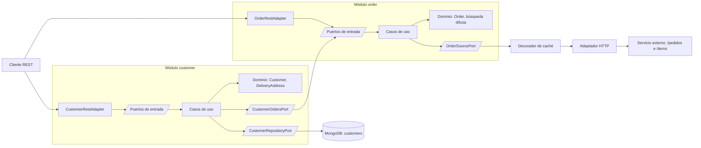

# Liverpool – Clientes y pedidos

Servicio backend (Java 21, Spring Boot 4, MongoDB) con arquitectura hexagonal que:

1. gestiona **clientes** y sus **direcciones de entrega**;
2. muestra en cada cliente sus **pedidos** (`orders`);
3. ofrece una **búsqueda tipo type-ahead** de pedidos por número, fecha estimada, tienda y producto.

## Requisitos

Hay que tener instalado:

| Herramienta | Para qué | Dónde conseguirla |
|---|---|---|
| **Java 21** (JDK) | Compilar y ejecutar la aplicación | <https://adoptium.net/temurin/releases/?version=21> |
| **Docker** | Ejecutar MongoDB en un contenedor | <https://docs.docker.com/get-started/get-docker/> |

No hace falta instalar Maven: el proyecto incluye el wrapper (`./mvnw`), que descarga la versión que necesita. Tampoco hace falta descargar la imagen de MongoDB a mano: Docker la baja solo la primera vez.

Para comprobar lo que ya tienes instalado:

```bash
java -version          # debe indicar la versión 21
docker --version
docker compose version
```

Puertos que se usan: **8080** (la aplicación) y **27017** (MongoDB). Deben estar libres.

## Cómo levantarlo en local

```bash
docker compose up -d                                          # MongoDB en localhost:27017
./mvnw spring-boot:run -Dspring-boot.run.profiles=demo        # arranca y carga 7 clientes de prueba
```

- Swagger UI: <http://localhost:8080/swagger-ui.html>
- OpenAPI (JSON): <http://localhost:8080/v3/api-docs>

Notas:

- **La primera vez tarda más y necesita internet:** se descargan la imagen de MongoDB (cerca de 1 GB), Maven y las dependencias de la aplicación. Las siguientes veces arranca en segundos.
- **En Windows** el comando es `mvnw.cmd` en lugar de `./mvnw`.
- **La búsqueda y el campo `orders` dependen de un servicio externo de pedidos,** por lo que necesitan internet. Sin conexión, la aplicación arranca pero la búsqueda responde 503 y los clientes se devuelven sin el campo `orders`.
- **El perfil `demo`** carga 7 clientes ficticios: los 6 `userId` que existen en el servicio de pedidos y uno sin pedidos. La carga se hace justo después de arrancar y tarda alrededor de un segundo; si ya existen, los omite. Sin el perfil la aplicación arranca sin datos.
- **Para usar otro MongoDB,** define `MONGODB_URI` (por ejemplo `mongodb://host:27017/liverpool`).
- **Para apagar la base:** `docker compose down` (con `-v` también borra los datos).

> Si tu instalación de Docker usa el comando antiguo, es `docker-compose` en lugar de `docker compose`.

## Ejemplos

```bash
# Cliente con pedidos (usuario sembrado)
curl localhost:8080/api/v1/customers/75c97531-abf5-4524-8107-90aa48d08efc

# Crear un cliente (userId opcional: si se omite, se genera un UUID)
curl -X POST localhost:8080/api/v1/customers -H 'Content-Type: application/json' -d '{
  "firstName": "Laura", "paternalLastName": "Gómez", "maternalLastName": "Pérez",
  "email": "laura@example.com"}'

# Actualizar datos personales
curl -X PUT localhost:8080/api/v1/customers/{userId} -H 'Content-Type: application/json' -d '{
  "firstName": "Laura", "paternalLastName": "Gómez", "email": "laura.gomez@example.com"}'

# Agregar una dirección
curl -X POST localhost:8080/api/v1/customers/{userId}/delivery-addresses \
  -H 'Content-Type: application/json' -d '{
  "street": "Av. Santa Fe", "exteriorNumber": "123", "neighborhood": "Santa Fe",
  "zipCode": "01210", "city": "Ciudad de México", "state": "CDMX"}'

# Fijar otra dirección como predeterminada / eliminar una dirección
curl -X PUT    localhost:8080/api/v1/customers/{userId}/delivery-addresses/{addressId}/default
curl -X DELETE localhost:8080/api/v1/customers/{userId}/delivery-addresses/{addressId}

# Búsqueda de pedidos
curl -G localhost:8080/api/v1/orders/search --data-urlencode 'q=pontalon levis'
curl -G localhost:8080/api/v1/orders/search --data-urlencode 'storeName=santa fe'
curl -G localhost:8080/api/v1/orders/search --data-urlencode 'orderStatus=2025-12'
curl -G localhost:8080/api/v1/orders/search --data-urlencode 'q=xbox' --data-urlencode 'storeName=toluca'

# Detalle de un pedido
curl localhost:8080/api/v1/orders/632005897
```

## API

| Método y ruta | Descripción |
|---|---|
| `POST /api/v1/customers` | Crear cliente (201) |
| `GET /api/v1/customers/{userId}` | Consultar, con `orders` |
| `PUT /api/v1/customers/{userId}` | Actualizar nombre, apellidos y correo |
| `POST /api/v1/customers/{userId}/delivery-addresses` | Agregar dirección (201) |
| `GET /api/v1/customers/{userId}/delivery-addresses` | Listar direcciones |
| `GET /api/v1/customers/{userId}/delivery-addresses/{addressId}` | Consultar una |
| `PUT /api/v1/customers/{userId}/delivery-addresses/{addressId}` | Reemplazar |
| `DELETE /api/v1/customers/{userId}/delivery-addresses/{addressId}` | Eliminar (204) |
| `PUT /api/v1/customers/{userId}/delivery-addresses/{addressId}/default` | Fijar predeterminada (204) |
| `GET /api/v1/orders/search?q=&orderRef=&orderStatus=&storeName=` | Buscar pedidos (al menos un criterio) |
| `GET /api/v1/orders/{orderRef}` | Detalle de un pedido |

Los errores usan **Problem Details** (RFC 7807): 400 datos inválidos, 404 no encontrado, 409 conflicto y 503 servicio de pedidos no disponible.

## Arquitectura

Dos módulos independientes, `customer` y `order`, cada uno con arquitectura hexagonal (puertos y adaptadores).



```
com.liverpool
├── customer
│   ├── domain/                      Customer, DeliveryAddress, Email, UserId
│   ├── application/
│   │   ├── port/in/                 puertos de entrada: CreateCustomerUseCase, GetCustomerUseCase…
│   │   ├── port/out/                puertos de salida: CustomerRepositoryPort, CustomerOrdersPort
│   │   ├── usecase/                 implementaciones: CreateCustomerHandler…
│   │   ├── command/ · view/         datos de entrada y de salida de los casos de uso
│   │   └── exception/
│   └── infrastructure/
│       ├── in/rest/                 CustomerRestAdapter (+ cuerpos y manejo de errores)
│       ├── in/seed/                 DemoDataSeeder
│       ├── out/mongo/               MongoCustomerRepositoryAdapter (+ documento y mapeo)
│       ├── out/orders/              OrderModuleOrdersAdapter (hacia el módulo order)
│       └── config/                  CustomerModuleConfiguration
└── order
    ├── domain/                      Order, OrderItem, búsqueda difusa
    ├── application/                 port/in · port/out · usecase · exception
    └── infrastructure/
        ├── in/rest/                 OrderRestAdapter
        ├── out/http/                MockApiOrderSourceAdapter
        ├── out/cache/               CachingOrderSourceAdapter (decorador)
        └── config/
```

El flujo de una petición es: adaptador de entrada (`in`) → puerto de entrada (`port/in`) → caso de uso (`usecase`) → puerto de salida (`port/out`) → adaptador de salida (`out`).

Las reglas de dependencias las verifica [ArchitectureTest](src/test/java/com/liverpool/ArchitectureTest.java).

## Pruebas y calidad

```bash
./mvnw clean verify      # CheckStyle + pruebas
```

- **CheckStyle** (configuración de Google): corre en la fase `validate`; cualquier violación hace fallar el build.
- **Pruebas unitarias** del dominio, los casos de uso y los adaptadores, y **ArchUnit** para la arquitectura.
